# REA Desktop · REA 桌面版

**English** · [中文](README.md) · [Quick start](#quick-start) · [Data and privacy](#data-and-privacy)

---

**REA Desktop puts most of REA's local reverse-engineering tools behind a visual workspace.**

Drop in an app → pick what you want to know → get an evidence-linked explanation → keep asking, and open the raw evidence at any time. The target app is never launched; you don't memorize tool names or hand-write JSON arguments.

Sections: [What this is](#what-this-is) · [Why the desktop app](#why-the-desktop-app) · [Architecture](#architecture) · [Quick start](#quick-start) · [Interface](#interface) · [Reports and evidence](#reports-and-evidence) · [Capability Center](#capability-center) · [REA capability → desktop entry point](#rea-capability--desktop-entry-point) · [Code recovery](#code-recovery) · [Model configuration](#model-configuration) · [Analysis engine](#analysis-engine) · [Long tasks and recovery](#long-tasks-and-recovery) · [History management](#history-management) · [Data and privacy](#data-and-privacy)

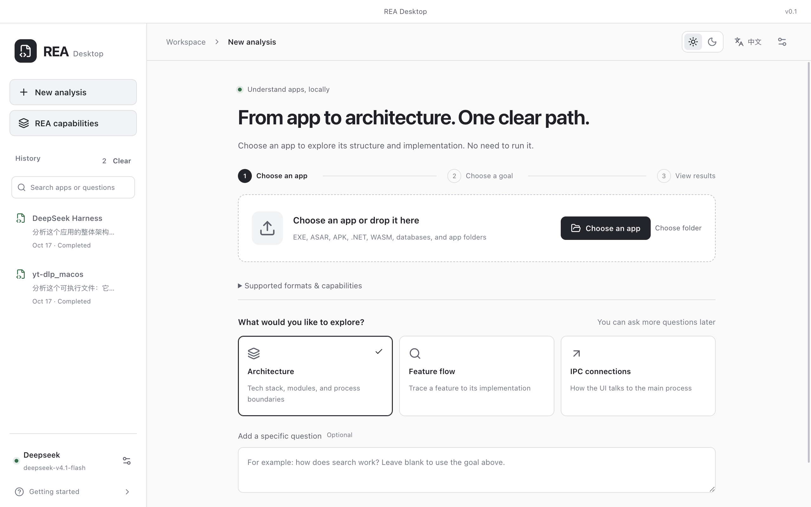

> Screenshots come from real running windows; all analysis targets are open-source software.

## What this is

[REA (Reverse Engineer Anything)](https://github.com/morluto/rea) is a local reverse-engineering toolkit (MIT, [rea.tools](https://rea.tools/)) that exposes a broad set of **MCP tools** plus a CLI. It performs analysis and returns structured evidence — it deliberately does **not** write the natural-language investigation. REA Desktop supplies that missing half. All analysis is performed by the bundled **REA 6.5.0**; nothing is reimplemented or bypassed.

| Layer            | REA provides                              | REA Desktop adds                                                                                       |
| ---------------- | ----------------------------------------- | ------------------------------------------------------------------------------------------------------ |
| Tool execution   | MCP tools and evidence contracts          | Capability Center: task categories, availability diagnostics, schema-driven forms, effect confirmation |
| Investigation    | Left to an external agent                 | Built-in model tool loop: three protocols, continuation, context compaction, checkpoint recovery       |
| Evidence         | Evidence bundle import/export             | Evidence panel: paging, click-through, copy, Markdown/JSON export                                      |
| Target detection | A caller-supplied `format`                | Drag-and-drop recognition of 38 formats, `.app` → ASAR resolution, unpacked verification               |
| Sessions         | Stateless (cleared on close)              | Tasks on disk, restart recovery, history search, delete one entry or clear all, resume                 |
| Environment      | Needs Node (and engines for some formats) | Bundled Node runtime — nothing for the user to install                                                 |

## Why the desktop app

| In a terminal / generic agent                              | In REA Desktop                                                                                                                                        |
| ---------------------------------------------------------- | ----------------------------------------------------------------------------------------------------------------------------------------------------- |
| Search through dozens of tool names, guess which ones work | Task categories, Chinese labels, one-line descriptions, live "N available" with reasons and fixes                                                     |
| Hand-write JSON arguments                                  | Forms generated from each tool's contract: enums, booleans, arrays, union branches, ranges, path pickers, evidence autocomplete, plus a raw JSON mode |
| No idea whether a tool mutates the target or runs code     | Every tool shows its **effects**; `mutatesTarget` / `executesForeignCode` / `changesUiState` / `mayDiscardData` require explicit confirmation         |
| A wall of JSON to `jq` through                             | Evidence panel with app facts, statistics, paged modules/functions, records and JSON preview                                                          |
| The model cites `ev_3f2a…` and you go hunting              | Evidence in reports is a clickable link that opens the exact record                                                                                   |
| Truncated output, start over                               | Automatic continuation, context compaction and checkpoints; retry with an empty question resumes from the breakpoint                                  |
| Close the terminal, lose everything                        | Tasks, conversations, evidence and model progress persist; history restores evidence automatically, and entries can be deleted or cleared             |
| Guess whether the file is PE, .NET or PyInstaller          | Format family, architecture, .NET managed flag and PyInstaller packaging are detected and shown up front                                              |

## Architecture

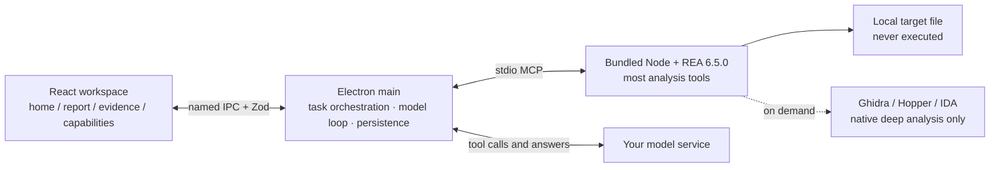

Targets are analysed locally and never uploaded; only your question and the selected evidence go to the configured model service. The model never receives `open_binary`, arbitrary path I/O or command execution tools — only read-only tools scoped to the current task's evidence.

## Quick start

```sh
npm ci          # Node 24.15.0 per .nvmrc
npm run dev     # Electron with hot reload
npm run build && npm run start   # preview the production build
CSC_IDENTITY_AUTO_DISCOVERY=false npm run build:mac   # macOS app + DMG
```

The runtime is prepared automatically before dev/build; end users need no Node, global REA, Python or Ghidra to analyse JavaScript/ASAR.

Three steps on the home screen: **pick an app → pick a goal → start**. Supported inputs include `.app`, `.asar`, JavaScript directories, EXEs, ELF, Mach-O, .NET assemblies, Android packages, installers, WASM, SQLite and capture files. Goals are _Overall architecture_, _Feature implementation_ and _IPC communication_; the free-text question is optional — a default question is generated from the selected goal. With no model configured, static analysis, evidence browsing, code recovery and export all still work.

ASAR targets default to **fast architecture analysis**: the complete file index is kept, and up to 24 small manifests/entries/preload/HTML files (≤ 100 KB each, ≤ 350 KB total) are parsed by REA, with SHA-256 verification against the archive manifest. Choose **full static analysis** in the advanced options for a wider scope. If the archive references `app.asar.unpacked`, pick the companion directory (or just select the whole `.app`).

**Large inventories and the MCP transport budget.** A single stdio response has a budget of about **10 MiB**. The complete inventory of a `.dmg`, `.pkg` or large `.ipa` easily exceeds it, and REA answers with `resource_constraint`. The desktop treats that as a size problem, not a failure: installer targets request `detail: 'summary'` up front, which keeps the **same coverage** (`examined == total`, `exhausted: true`) without shipping every entry over the wire; Apple `.app` bundles try the complete inventory first, because Apple graph projection needs it, and fall back only when the budget is genuinely exceeded. If a call still overruns, the UI says the analysis finished, names the retained `evidence_id`, and points at summary mode or reading the evidence by ID in the Capability Center.

## Interface

| Light (zh)                        | Dark (zh)                       |
| --------------------------------- | ------------------------------- |
| 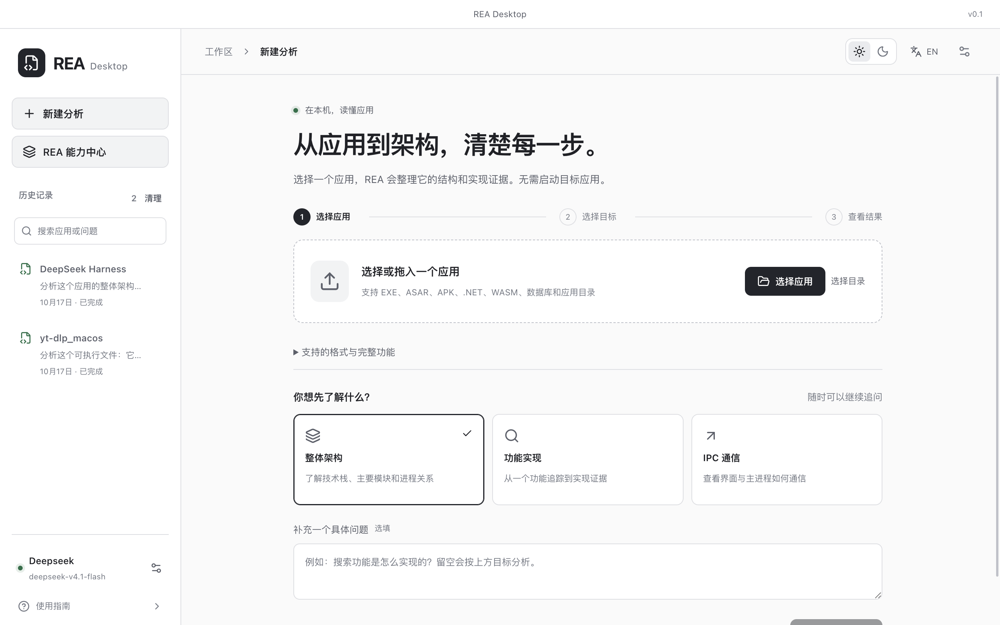 | 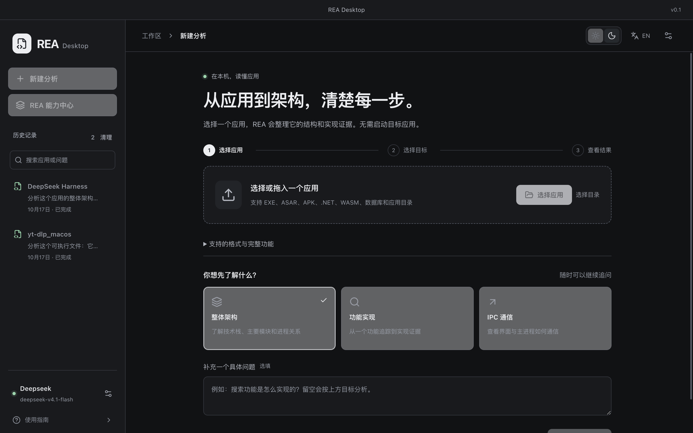 |

| Light (en)                        | Dark (en)                       |
| --------------------------------- | ------------------------------- |
|  | 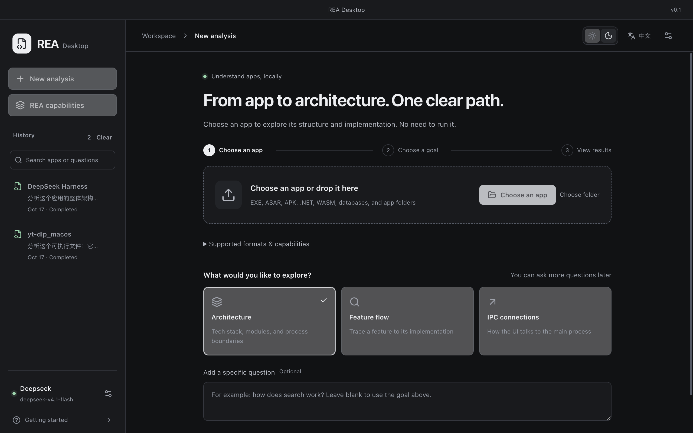 |

- Left sidebar: New analysis, **REA Capability Center**, history with search, model status, user guide.
- Header: breadcrumb, light/dark toggle, `EN` / `中文` toggle, settings.
- Task toolbar: `Code`, `Tools`, status badge, `Evidence N`, `Export`.
- Theme and language are stored in `preferences.json` and restored on restart; reports are generated in the currently selected language, while historical input, reports and raw evidence keep their original text.

## Reports and evidence

Reports are Markdown, organized as conclusion → layered observations → verification → limitations, and must distinguish **observed / derived / unknown** and cite `ev_…` evidence. Those citations are clickable links that open the evidence panel.

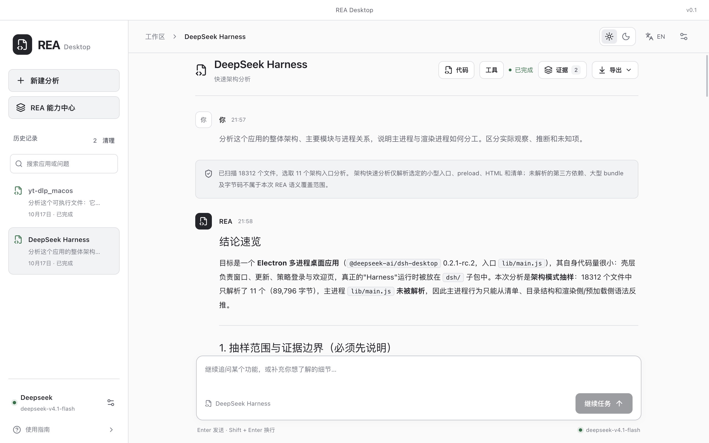

The evidence panel shows app facts and sampling scope, a statistics grid (archived files, parsed files, files, IPC channels), paged modules or native functions (16 per page; clicking a native function jumps into code recovery), the evidence records with titles and short IDs, a JSON preview (capped at 100,000 characters and clearly marked when truncated), and a collapsible section for coverage and unknowns.

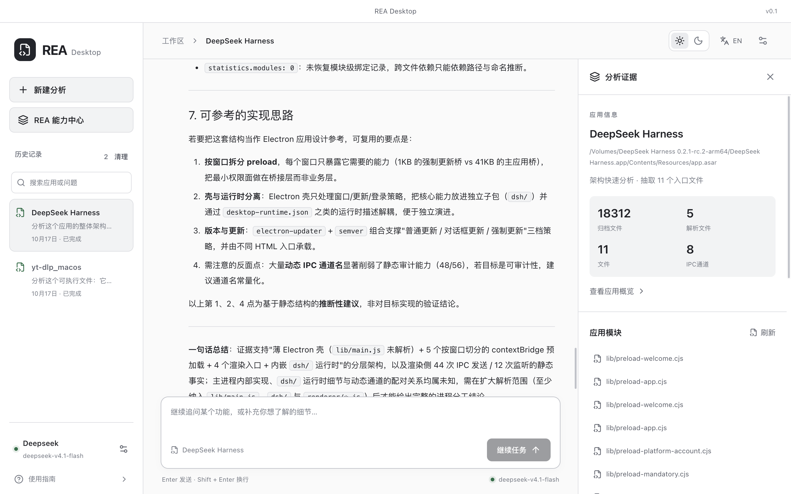

`ev_…` identifiers are REA-native evidence; `obs_…` are desktop-saved raw observations, and the two are never mixed. Export gives you a **Markdown report** (conversation + analysis summary + evidence index) or the **REA canonical JSON evidence bundle** (re-importable by REA, plus a `.desktop.json` sidecar of desktop observations and scope).

## Capability Center

The Capability Center is the visual layer over most of REA's tools.

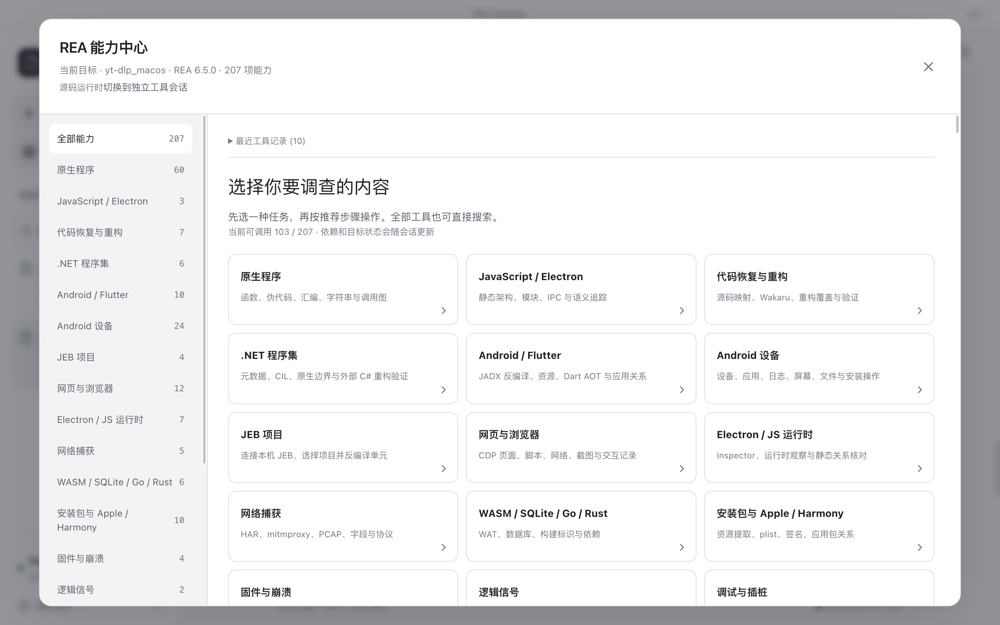

- Tools are grouped into task categories — native, JavaScript / Electron, Android, network capture and more — each with a recommended workflow such as _open target → overview → browse functions → decompile → analyze → call graph_.
- Availability is live: `target_required`, `provider_missing`, `unsupported_host` and friends come with remediation hints. An unconfigured capability states its reason instead of passing "file recognised" off as "decompiled".
- Selecting a tool shows its full REA contract, a contract-driven parameter form (objects, arrays, union branches, file paths, evidence arguments) with a raw **JSON mode**, reuse of earlier results, its **effects**, a confirmation checkbox for consequential operations, and the real execution result with expandable raw JSON, copy and export.
- The last 30 standalone tool runs are kept locally and can refill the form. Tool sessions persist until the app exits; referencing evidence across sessions requires importing the native evidence bundle.

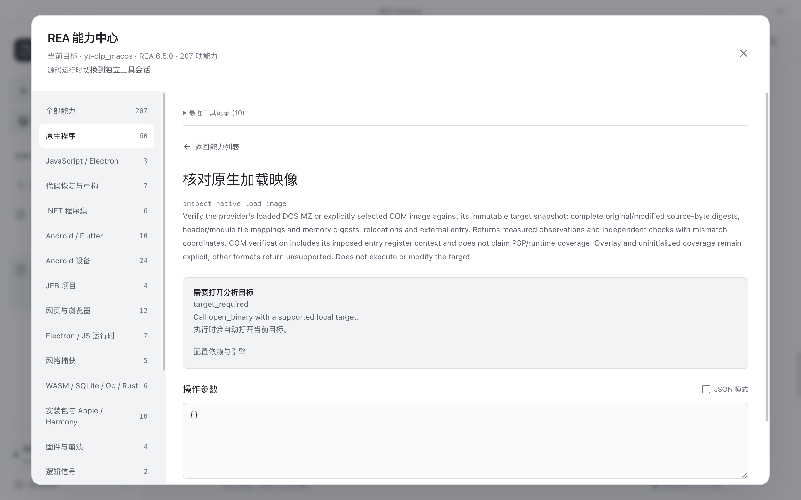

## REA capability → desktop entry point

Most REA tools are reachable from the UI. This table says **where each capability lives in the interface**, and what the desktop layer adds around it.

| REA capability (tool group)                                                                            | Desktop entry point                           | What the desktop adds                                                                                          |
| ------------------------------------------------------------------------------------------------------ | --------------------------------------------- | -------------------------------------------------------------------------------------------------------------- |
| Session & target (`binary_session`, `open_binary`, `close_binary`)                                     | Automatic on drop; "Session" category by hand | Format family detected from the file header and opened for you — no `format` argument, no connection lifecycle |
| JavaScript / Electron (`analyze_javascript_application`)                                               | Home → pick app → start                       | Entry snapshots, full file index, per-file SHA-256 verification, sampling scope recorded in the report         |
| Native (`binary_overview`, `procedure_pseudo_code`, call graphs)                                       | Analysis → Evidence panel, "Functions"        | Paged Ghidra function list; click a function to jump straight into code recovery                               |
| .NET (`inspect_managed_artifact`, `inspect_managed_members`)                                           | Home (PE/CLI auto-detected)                   | Managed flag detected up front, correct tool group chosen automatically                                        |
| Android / Flutter (`inspect_android_package`, `identify_flutter_build`)                                | Home on `.apk / .aab`                         | Package structure, permissions and Flutter detection in one pass; JADX setup hints when missing                |
| Installers & Apple / Harmony (`inspect_artifact`, `project_apple_application_graph`)                   | Home on `.dmg / .pkg / .app / .ipa / .hap`    | Oversized inventories fall back to the summary view while keeping full coverage                                |
| Data & config (`inspect_plist`, `inspect_sqlite_database`, `inspect_wasm_artifact`)                    | Home on `.plist / .db / .sqlite / .wasm`      | Schemas, key/value pairs and WAT shown as tables and previews instead of raw JSON                              |
| Network capture (`inspect_web_network_capture`, `inspect_pcap_capture`)                                | Home on `.har / .saz / .qlog / .pcap`         | Records laid out as rows; missing TShark reported with a concrete reason                                       |
| Firmware / EVM / crash (`inspect_firmware_regions`, `inspect_evm_interface`, `inspect_recorded_crash`) | Home on the matching format                   | Linux-only toolchains point you at a remote REA service instead of failing silently                            |
| Web & runtime (`inspect_web_page`, `analyze_web_bundle`)                                               | Home, Chrome CDP / Electron Inspector target  | Endpoint and target are chosen explicitly in the form, never guessed                                           |
| Compare & evidence correlation                                                                         | Capability Center category                    | A previous result is reusable as the next tool's argument in one click                                         |
| Signal decoding (`decode_signal_recording`)                                                            | Capability Center, "Logic signal"             | Missing decoder/channel arguments are requested in the form instead of erroring out                            |

Two things REA deliberately leaves to the host, and the desktop supplies: the **natural-language investigation** (a built-in model tool loop that chains REA tools and writes an evidence-linked report) and **long-running durability** (checkpoints, continuation, compaction, "continue task"). Everything else above is REA's own analysis, called through the real MCP contract.

To call any tool by hand: **Capability Center → search by tool name / label / format → schema-driven form or raw JSON mode → confirm effects → run**. The last 30 runs are kept locally and can refill the form.

## Code recovery

`Code` opens **Code recovery & export**: PyInstaller archives (CArchive parsing, PYZ and `.pyc` extraction, native loader decompilation for a given function), ASAR/JavaScript/source maps (shipped scripts and embedded `sourcesContent`), source directories, .NET assemblies (CIL and metadata), WASM (WAT) and native procedures (pseudocode by function name or address). Output lands in `recovered/<uuid>/` with a source manifest labelling each file's output type, origin and size; the UI offers a filterable file list, a preview pane (bytecode shown as hex), reveal-in-folder and folder export. Skipped items and limitations are always recorded — missing source is never fabricated.

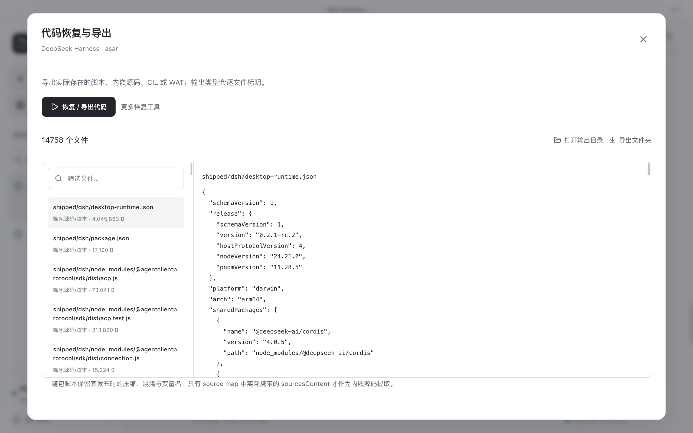

Original-source caveat: REA cannot guarantee pre-compilation variable names, comments, dependencies or a complete project. Native output is pseudocode; .NET output is CIL/metadata with external C# reconstruction verification; Flutter AOT is not original Dart source; only content actually embedded in a source map is labelled as embedded source.

## Model configuration

Three protocols are supported: **OpenAI Chat Completions** (`/chat/completions`), **Anthropic Messages** (`/v1/messages`) and **OpenAI Responses** (`/responses`). Multiple profiles can be saved and switched; the next question uses the active profile, while a running tool loop keeps the profile it started with. Presets cover OpenAI, DeepSeek, Volcengine Ark and Coding Plan. "Check connection" performs a real tool-call round-trip — a text-only reply does not count as success. **CC Switch import** reads `~/.cc-switch/cc-switch.db` read-only and recognises Claude, Claude Desktop, Codex, OpenCode and Pi API-key profiles; OAuth subscription logins are not API keys and are not imported. Keys are encrypted with Electron `safeStorage` and never reach the renderer.

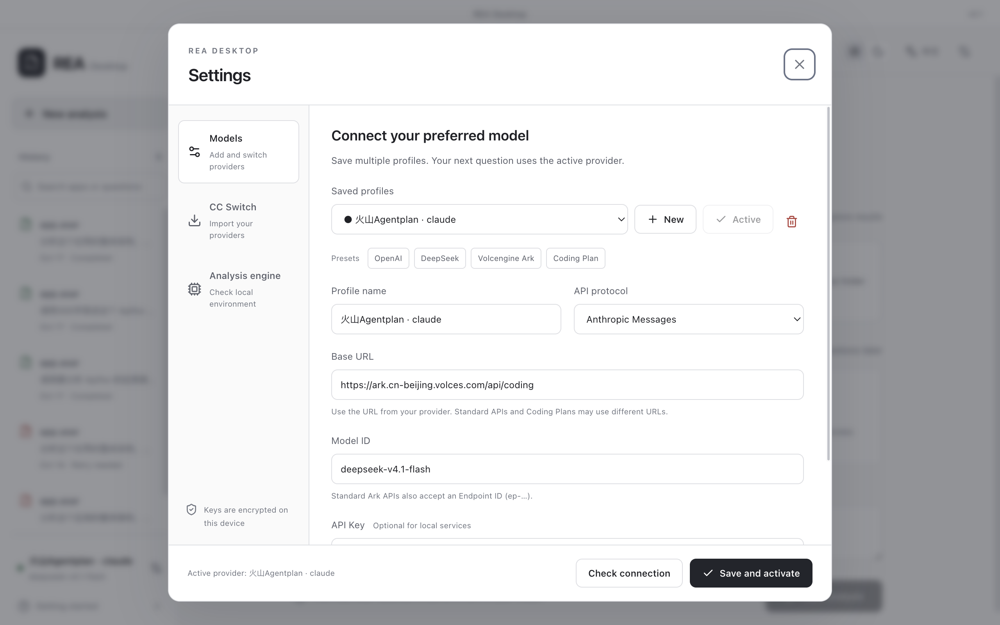

## Analysis engine

REA and Node are bundled — JavaScript/ASAR, .NET static analysis, Go/Rust metadata, HAR and archives need no configuration. The engine tab configures optional external tooling per target type: provider (`auto` / `ghidra` / `hopper` / `ida`), labelled environment variables (`GHIDRA_INSTALL_DIR`, `JAVA_HOME`, `REA_GHIDRA_STARTUP_TIMEOUT_MS`, `REA_JADX_MCP_JAR`, `REA_JEB_MCP_URL`, `REA_ADB_COMMAND`, `REA_APKTOOL_COMMAND`, `REA_WABT_BIN_DIRECTORY`, `REA_TSHARK_COMMAND`, `REA_WAKARU_COMMAND`, …), an optional **custom REA service** (for example `ssh user@linux-host node /opt/rea/scripts/rea.mjs mcp` to reach host-restricted capabilities), and diagnostics showing REA version, available capabilities, runtime path and per-provider status with reasons. macOS auto-detects an installed JDK without touching global Node/Java settings.

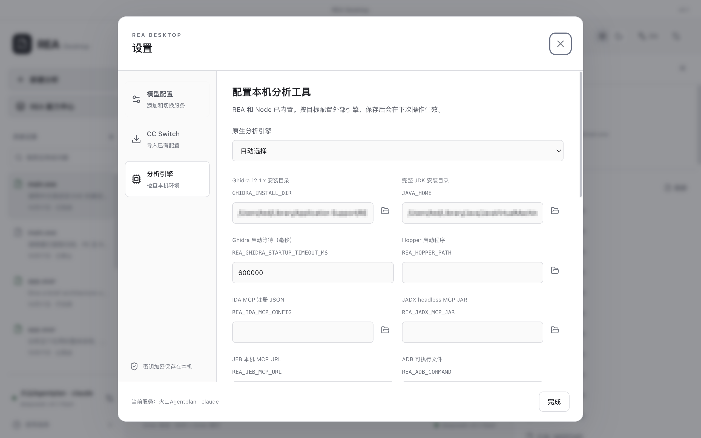

## Long tasks and recovery

Up to 32 tool rounds and 48 main-loop requests per run, up to 8 automatic continuations, context compaction once the estimate passes 24,000 tokens, and a 180-second timeout per model request. Truncated tool arguments are never executed; the request is retried with a larger output budget. A checkpoint (`tasks/<ID>/model-run.json`, no API key) is written between complete tool rounds, so an interrupted run resumes from the breakpoint — and the completed static analysis is never redone. Compaction summaries preserve the original question, confirmed findings, evidence IDs, inferences and unknowns, query parameters and next steps.

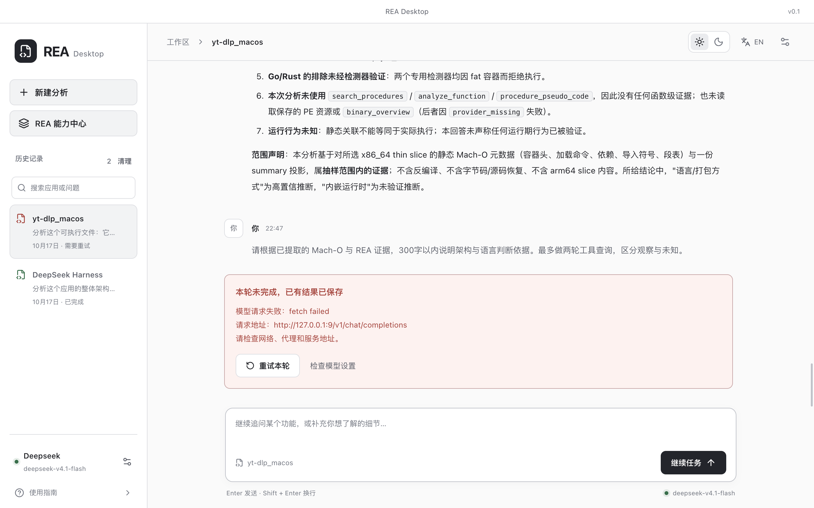

## History management

The sidebar lists every analysis run stored on this machine, searchable by app name, path or question.

| Action            | Where                                          | What happens                                                                                    |
| ----------------- | ---------------------------------------------- | ----------------------------------------------------------------------------------------------- |
| Reopen a run      | Click a history entry                          | Conversation, report and evidence come back; the native REA bundle is re-imported automatically |
| Delete one entry  | Hover the entry → trash icon on the right      | Confirmation dialog, then the whole `tasks/<ID>/` directory is removed                          |
| Clear all history | "Clear" in the history heading (shows a count) | One confirmation, then every task directory is removed                                          |

Deletion is **physical and not undoable** — task file, evidence bundle, recovered sources and model checkpoint all go. It never touches model profiles, engine settings or the last-30 tool runs. Entries cannot be renamed, and a running task must be finished or stopped before it can be deleted.

## Data and privacy

Workspace data lives in `~/Library/Application Support/REA Desktop/workspace`: `settings.json` (active profile, profiles, encrypted keys), `engines.json`, `preferences.json`, `tool-runs/` (last 30 runs, without inherited process environment), and per task `tasks/<ID>/{task,evidence,model-run}.json`, `records/`, `recovered/` and `artifact/{inventory,scope}.json` plus `artifact/source/` (entry snapshots, never executed). Deleting a history entry removes its whole `tasks/<ID>/` directory; `tool-runs/` and the settings files are untouched.
