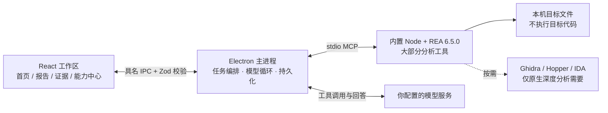
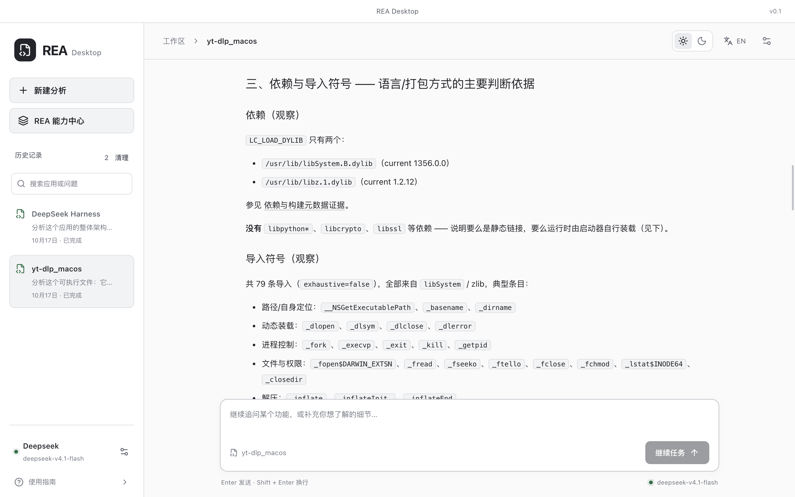
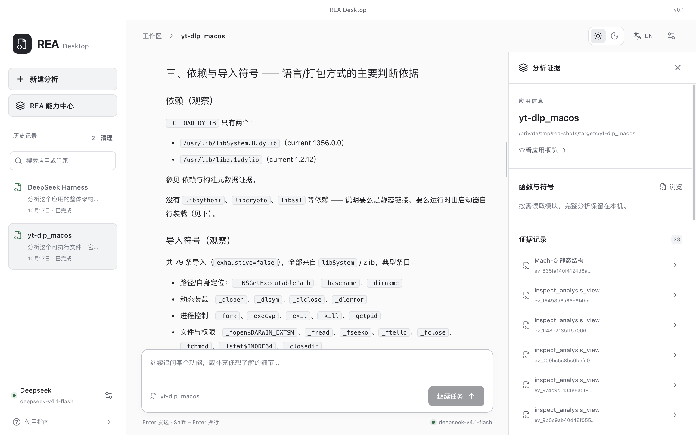
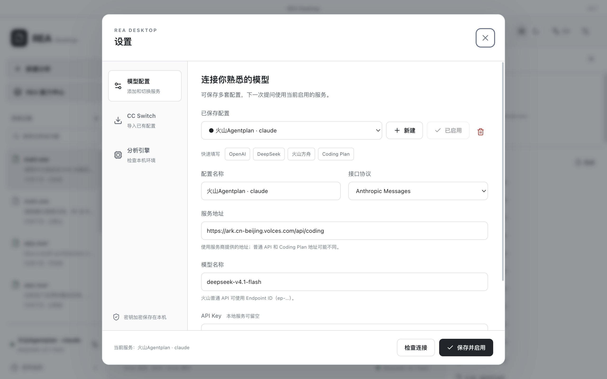

# REA Desktop · REA 桌面版

**REA Desktop（REA 桌面版）是 [REA（Reverse Engineer Anything）](https://github.com/morluto/rea) 的本地桌面客户端：把 REA 的大部分逆向分析能力装进一个可视化工作区。**

拖入一个应用 → 选择你想了解的内容 → 得到带证据链接的中文解释 → 随时追问、随时点开原始证据。不需要启动目标应用，不需要记工具名，不需要手写 JSON 参数。

[](https://github.com/morluto/rea)
[](#八rea-能力中心)
[](#五支持的输入格式)
[](https://www.electronjs.org/)
[](https://react.dev/)
[](https://www.typescriptlang.org/)

**中文** · [English](README.en.md) · [快速开始](#三快速开始) · [常见问题](#十七常见问题)


> 本文档截图均来自真实运行界面，分析目标为开源软件。

---

### 目录

|                                                           |                                         |                                                              |
| --------------------------------------------------------- | --------------------------------------- | ------------------------------------------------------------ |
| 一、[这是什么](#一这是什么)                               | 二、[架构总览](#二架构总览)             | 三、[快速开始](#三快速开始)                                  |
| 四、[界面导览](#四界面导览)                               | 五、[支持的输入格式](#五支持的输入格式) | 六、[分析方式](#六分析方式)                                  |
| 七、[报告与证据](#七报告与证据)                           | 八、[REA 能力中心](#八rea-能力中心)     | 九、[REA 能力 → 桌面版入口对照](#九rea-能力--桌面版入口对照) |
| 十、[代码恢复与导出](#十代码恢复与导出)                   | 十一、[模型配置](#十一模型配置)         | 十二、[分析引擎设置](#十二分析引擎设置)                      |
| 十三、[长任务、预算与自动恢复](#十三长任务预算与自动恢复) | 十四、[历史记录管理](#十四历史记录管理) | 十五、[数据、隐私与安全](#十五数据隐私与安全)                |
| 十六、[本机数据目录](#十六本机数据目录)                   | 十七、[常见问题](#十七常见问题)         | 十八、[工程命令与技术栈](#十八工程命令与技术栈)              |

### 一、这是什么

#### 1.1 REA 是什么

[REA（Reverse Engineer Anything）](https://github.com/morluto/rea) 是一套本地逆向分析工具集合。它把「读取目标 → 解析 → 追踪 → 出证据」这一整套流程做成 **MCP工具**，同时提供 CLI：

- 它**只做分析，不做解释**。REA 不会用自然语言告诉你「这个功能怎么实现的」，它负责执行工具、返回结构化证据。
- 它可以作为 **MCP server** 被任意 Agent 调用：`node node_modules/rea-agents/scripts/rea.mjs mcp`（stdio）。
- 它对目标的读取是静态的：JavaScript/ASAR、.NET、WASM、SQLite、HAR 等格式**不需要**额外安装 Ghidra、Python 或 Hopper；只有原生二进制深度反编译等能力才依赖外部引擎。
- 它输出的每条结论都带 `evidence_id`（`ev_…`），区分「观察到的」与「推断的」，并显式保留 `limitations`、`coverage` 与未知项。

#### 1.2 桌面版做了什么

桌面版没有重写 REA，也没有绕开 REA——**所有分析都由随包携带的REA完成**。桌面版补上的是 REA 刻意留给宿主的那一半：

| 环节         | REA 提供                      | 桌面版补上                                                   |
| ------------ | ----------------------------- | ------------------------------------------------------------ |
| 工具执行     | MCP 工具与证据契约            | 能力中心：任务分类、可用性诊断、参数表单、风险确认           |
| 自然语言调查 | 由外部 Agent 完成             | 内置模型工具循环：三种协议、续写、上下文压缩、检查点恢复     |
| 证据管理     | Evidence Bundle 导入导出      | 证据面板：分页浏览、点击跳转、复制、导出 Markdown / JSON     |
| 目标识别     | 由调用方给出 `format`         | 拖入即识别 38 种格式，自动定位 `.app` 内 ASAR、校验 unpacked |
| 会话         | 无状态（关闭即清空）          | 任务落盘、重启恢复、历史检索、断点续跑                       |
| 环境         | 需要 Node（部分格式还需引擎） | 内置独立 Node 运行时，开箱即用                               |


#### 1.3 为什么用桌面版，而不是在终端里调 REA

REA 的 CLI 与 MCP 契约是给「已经知道自己在找什么」的人用的。桌面版把这些能力变成可浏览、可确认、可追溯的界面：

| 在命令行 / 通用 Agent 里要做的事               | 在桌面版里怎么做                                                                                                                                        |
| ---------------------------------------------- | ------------------------------------------------------------------------------------------------------------------------------------------------------- |
| 记住或搜索大量工具名，判断哪个能用             | **能力中心**按任务分类组织，中文标签 + 一句话说明，并实时标注「当前可调用 N 项」与不可用原因                                                            |
| 手写 JSON 参数，猜字段名和取值范围             | **动态参数表单**由工具自身契约生成：枚举下拉、布尔勾选、数组增删、联合类型分支、范围校验；路径字段带「选择文件 / 目录 / 另存为」，Evidence 字段自动补全 |
| 不知道某个工具会不会改动目标或执行代码         | 每个工具标注**操作影响**（`mutatesTarget`、`executesForeignCode`、`changesUiState`、`mayDiscardData`…），危险操作必须勾选确认才能执行                   |
| 分析结果是一大坨 JSON，`jq` 里翻半天           | **证据面板**分列展示应用信息、统计数字、模块/函数分页、证据记录与 JSON 预览                                                                             |
| 模型说「见 `ev_3f2a…`」，还要自己查这个 ID     | 报告里的证据是**可点击链接**，点开即定位到证据面板中对应的那条记录                                                                                      |
| 长报告被输出上限截断，只能重来                 | 自动**续写、压缩上下文、保存检查点**；出错后留空问题点「继续任务」即可从断点继续                                                                        |
| 关闭终端，一切归零                             | 任务、对话、证据、模型进度全部落盘；重启后从左侧历史点回去，证据自动重新导入；历史可搜索、可单条删除、可一键清理                                        |
| 要自己判断拖进来的是 PE、.NET 还是 PyInstaller | 拖入即识别格式族、架构、是否 .NET 托管、是否 PyInstaller 打包，并给出该目标该用哪组工具                                                                 |

### 二、架构总览



两条数据路径彼此独立：

- **本机路径**：REA 在本机读取目标，产出证据，全程不联网。
- **模型路径**：只有「你的问题」和「被选取的证据片段」会发送到你配置的模型服务；目标文件本身不会上传。

模型**永远拿不到** `open_binary`、任意路径读写或命令执行类工具。桌面端只把当前任务证据范围内的只读工具暴露给模型，越权调用会被宿主直接拒绝；完整契约仍在能力中心可手动操作。

### 三、快速开始

#### 3.1 运行

使用 `.nvmrc` 指定的 Node 24.15.0：

```sh
npm ci
npm run dev
```

开发和构建前会自动准备独立 Node，最终用户无需安装 Node、全局 REA、Python 或 Ghidra 来分析 JavaScript/ASAR。REA 基础依赖锁定 `rea-agents@6.5.0`。当前工作区提供 `dist/rea` 源码时，构建会生成完整源码运行时并随应用打包，包含该源码中的 Kuna 等发布后能力；不修改供应源码。可用 `REA_SOURCE_DIR` 指定其他源码目录。无源码的新环境使用已锁定的 npm 运行时。

```sh
npm run build
npm run start
```

打包：

```sh
CSC_IDENTITY_AUTO_DISCOVERY=false npm run build:mac
```

Windows 本机也可运行 `npm run build:win` 打包。各平台必须使用与目标架构一致的 Node、Electron 和依赖，不能在 Intel 环境中仅增加 `--arm64` 就复用现有运行时。

#### 3.2 三步上手

首页按 **选择应用 → 选择目标 → 开始** 组织：

1. **选择应用**：拖入窗口，或点「选择应用 / 选择目录」。支持 EXE、ELF、Mach-O、Electron/ASAR、.NET、Android、安装包、WASM、SQLite、网络捕获等格式。选中后显示格式标签（如 `.NET / CIL`、`PyInstaller / Python`）与文件大小，并可一键跳到「这个格式对应哪组工具」。
2. **选择目标**：三张意图卡片——**整体架构**、**功能实现**、**IPC 通信**（非 JavaScript 目标会自动换成「格式、技术栈与主要模块」「系统交互」）。下方可补充具体问题，**留空也能开始**，桌面端会按所选意图生成默认问题。
3. **开始分析**：没有配置模型也能点——静态分析照常执行，结果以证据形式呈现，只是没有自然语言解释。


**进阶选项**（默认折叠）：分析范围（快速架构分析 / 完整静态分析）与「补充 unpacked 目录」。

### 四、界面导览

| 区域       | 内容                                                                                               |
| ---------- | -------------------------------------------------------------------------------------------------- |
| 顶部标题栏 | `REA Desktop` 与版本号；macOS 下为可拖拽的隐藏式标题栏                                             |
| 左侧栏     | 「新建分析」、「REA 能力中心」、历史记录（含搜索、单条删除与一键清理）、底部模型状态与「使用指南」 |
| 工作区头部 | 面包屑（工作区 › 应用名）、浅色/深色主题切换、中文 / EN 语言切换、设置入口                         |
| 主工作区   | 引导页或会话报告；证据面板按需从右侧展开                                                           |
| 任务工具栏 | 应用名 + 分析类型、`代码`、`工具`、状态徽标、`证据 N`、`导出`                                      |
| 输入区     | `Enter` 发送 · `Shift + Enter` 换行；运行中显示「停止」                                            |

- **主题与语言**：顶部太阳/月亮按钮切换浅色、深色；`EN` / `中文` 切换界面语言。偏好写入本机 `preferences.json`，重载和重启后恢复；没有保存过主题时采用系统外观，默认语言为中文。
- **语言作用范围**：新提问携带当前语言，模型报告按所选语言生成；历史输入、历史报告、服务商自定义名称与原始 REA 证据保持原文。

| 浅色中文                          | 深色中文                         |
| --------------------------------- | -------------------------------- |
|  |  |

| 浅色英文                          | 深色英文                         |
| --------------------------------- | -------------------------------- |
|  |  |

### 五、支持的输入格式

拖入或选择目标后，桌面端按文件头与扩展名识别格式与格式族（共 38 种格式、9 个族）：

| 格式族                    | 典型输入                                                                      | 说明                                                     |
| ------------------------- | ----------------------------------------------------------------------------- | -------------------------------------------------------- |
| JavaScript / Electron     | `.app`、`.asar`、`.js / .mjs / .cjs`、`.map`、源码目录                        | **无需任何外部引擎**，开箱即用，是主线场景               |
| 原生应用与库              | PE `.exe / .dll / .sys`、ELF `.so`、Mach-O、`.dylib`、DOS MZ / COM、Hopper 库 | 深度反编译需要 Ghidra / Hopper / IDA；离线布局分析不需要 |
| .NET 托管程序集           | PE/CLI `.exe / .dll`                                                          | 纯静态解析，无需额外依赖                                 |
| Android / Flutter         | `.apk / .aab / .dex / .jar / .jdb2`                                           | 反编译需要 JADX；资源与 Flutter 结构为静态解析           |
| 安装包与应用资源          | `.zip / .ipa / .msix / .appx / .dmg / .pkg / .app / .plist`、`.hap / .hsp`    | 归档成员、签名、plist、资源目录等                        |
| WASM / SQLite / Go / Rust | `.wasm`、`.db / .sqlite`、Go 与 Rust 可执行文件                               | WASM 使用内置 WABT；SQLite 使用内置 Node                 |
| 网络与逻辑记录            | `.har`、mitmproxy、`.saz`、`.qlog`、`.pcap / .pcapng`、`.vcd / .sr`           | 抓包需要 TShark / capinfos；逻辑信号需要 sigrok          |
| 固件 / EVM / 崩溃记录     | `.bin / .hex`、EVM 字节码、ELF core dump                                      | 固件提取需要 Binwalk / Unblob（Linux）                   |
| 网站与运行时              | Chrome CDP、Electron Inspector、Android ADB、JEB                              | 需要已启动的浏览器 / 设备 / 外部 MCP 服务                |

> 识别结果同时给出**架构**、**是否 .NET 托管**、**是否 PyInstaller 打包**（读取文件尾的 `MEI` cookie 与 Python 版本）等事实，直接决定后续该用哪组工具。原生 `.app` 会按 Apple bundle 分析；Electron `.app` 会自动寻找其中的 ASAR。

### 六、分析方式

#### 6.1 两种模式

|                | 快速架构分析（默认，ASAR）                                                                                | 完整静态分析                                     |
| -------------- | --------------------------------------------------------------------------------------------------------- | ------------------------------------------------ |
| REA 拿到的东西 | 抽样入口文件快照 + 完整文件索引                                                                           | 原始 ASAR 或目录，交给 REA 自行读取              |
| 选取规则       | 排除 `node_modules`；候选为 `package.json`、HTML/JSON 清单、main/preload/index 类 JS；按优先级 + 体积排序 | 不抽样                                           |
| 上限           | 最多 **24 个文件**、单文件 **≤ 100 KB**、累计 **≤ 350 KB**                                                | 受 REA 自身预算限制                              |
| 完整性校验     | 逐个校验归档声明的 SHA-256，不匹配即跳过并记录                                                            | 由 REA 处理                                      |
| 结果           | 完整文件索引 + 局部架构视图，界面与模型上下文明确标注抽样范围                                             | 范围更大，但大型依赖树可能耗时很久或达到引擎预算 |
| 适用           | 先看懂架构、定位入口、确认技术栈                                                                          | 需要更大覆盖范围时                               |

#### 6.2 操作要点

1. 拖入或选择分析文件；按文件头识别 PE/.NET、ELF、Mach-O、WASM、SQLite，其他格式按后缀分流。Electron `.app` 自动寻找 ASAR；原生 `.app` 按 Apple bundle 分析。
2. ASAR 默认使用「架构快速分析」：保存完整文件索引，按优先级选取至多 24 个小型清单、入口、preload、HTML，由 REA 实际解析。
3. 如果归档引用 `app.asar.unpacked`，需要配套目录。直接选择完整 `.app` 时自动使用其相邻目录；单独 ASAR 可点击「补充 unpacked 目录」。缺少目录时仍可分析归档内已有入口，并显示缺失数量。
4. 需要扩大范围时，新建任务选择「完整静态分析」。完整模式直接交给 REA，需把配套目录放在 ASAR 旁边，或直接选择完整 `.app`；界面补充目录用于快速分析。
5. 输入架构或功能问题；无需模型也可先分析、浏览模块和证据。

REA 每个源文件使用 2 GiB 堆上限、30 秒源分析预算；客户端为工具请求至少预留 31 分钟，并按显式 duration/timeout 延长，避免过早切断 Ghidra、Kuna 与较长捕获。停止任务会关闭分析进程。原生分析首次载入可能需要数分钟，后续函数查询复用当前 Ghidra 会话。

分析过程中界面显示真实阶段：正在连接本地分析引擎 → 正在准备应用架构入口与文件索引 → 正在使用 REA 分析应用结构与模块 → 正在保存本地分析证据 → 正在整理解释与证据。

#### 6.3 超大清单与 MCP 传输预算

桌面端通过 stdio 调用 REA，单次响应有约 **10 MiB** 的传输预算。`.dmg`、`.pkg`、大型 `.ipa` 这类安装包的**完整文件清单**很容易达到几万个条目、远超这个量级，REA 会返回 `resource_constraint`。

桌面端不会因此把分析判为失败：

- **自动改用摘要视图**：安装包类目标默认请求 `detail: 'summary'`。摘要视图**保留完整的清单覆盖范围**（同一份 Evidence，`examined == total`、`exhausted: true`，覆盖统计与结论不变），只是不再把每个条目都塞进传输内容。
- **Apple `.app` 单独处理**：Apple 结构投影需要完整清单 Evidence，因此先尝试完整模式，只有真的超出预算才退回摘要视图。
- **确实超限时给出可执行的提示**：界面会说明「分析已完成，但完整结果超过 MCP 传输预算，完整证据已保留在引擎中（`evidence_id: ev_…`）」，并建议改用摘要模式重新分析，或在能力中心按证据 ID 读取——**不会假装分析失败**。

### 七、报告与证据

#### 7.1 报告

模型回答以 Markdown 渲染，按「结论 → 分层观察 → 验证 → 局限」组织，并遵守两条硬规则：区分**观察 / 推断 / 未知**，不把静态可达关系说成运行行为；每个结论都能落到一条 `ev_…` 证据上，报告中以可点击链接呈现。


原生目标（此处为 PyInstaller 打包的可执行文件）的报告同样带证据引用，并明确写出「基于静态证据，非运行验证」：



#### 7.2 证据面板

点任务工具栏的「证据 N」展开右侧面板：

- **应用信息**：目标名、完整路径、分析类型与抽样规模；快速分析会显示「抽取 N 个入口文件」。
- **统计网格**：归档文件数、解析文件数、文件数、IPC 通道数。
- **应用模块 / 函数与符号**：按页读取（每页 16 项），原生目标显示 Ghidra 识别出的函数与地址；点模块看该页证据，点函数直接跳到代码恢复面板。
- **证据记录**：本次任务保存的每条证据，含中文标题与 `ev_…` 短 ID。
- **证据详情**：JSON 预览（最多 100,000 字符，超出明确标注「当前为部分预览」）、一键复制完整 ID。
- **覆盖范围与未确认项**：折叠展示 `limitations`、`unknowns` 与分析范围限制。


原生目标的证据面板列出 Ghidra 识别出的函数（`FUN_140001000` …），点击即可进入代码恢复：



#### 7.3 证据的两种身份

- `ev_…` 是 **REA 原生 Evidence**；`obs_…` 是**桌面端保存的原始观察**，二者不会混作同一种证据。
- 导出 JSON 时保留 REA 原生 canonical 证据包，并另存 `.desktop.json` 保存桌面观察、范围与限制信息；该证据包可被 REA 重新导入。
- Markdown 报告包含完整对话、分析摘要与证据索引，`rea://evidence/…` 链接会改写为纯证据 ID，便于在别处引用。

### 八、REA 能力中心

「能力中心」是桌面版对 REA 大部分工具的可视化封装。

- **任务分类**：原生程序、JavaScript / Electron、代码恢复与重构、.NET 程序集、Android / Flutter、Android 设备、JEB 项目、网页与浏览器、Electron / JS 运行时、网络捕获、WASM / SQLite / Go / Rust、安装包与 Apple / Harmony、固件与崩溃、逻辑信号、调试与插桩、进程与原生界面、比较与证据关联、会话、证据与未知项。
- **可用性实时标注**：头部显示「当前可调用 N 项」，每个工具前有状态圆点。不可用时给出**原因**（`target_required`、`provider_missing`、`unsupported_host`…）与**修复建议**（例如「执行时会自动打开当前目标」「可先执行 open_binary，或在设置中配置所需引擎后刷新」）。没有配置的能力显示具体原因，不会把「文件识别成功」冒充「反编译成功」。
- **推荐顺序**：每个分类给出一条工作流，例如原生程序组的「1 打开分析目标 → 2 应用概览 → 3 浏览函数 → 4 函数反编译 → 5 分析函数 → 6 生成调用图」。
- **搜索**：按工具名、中文标签、格式或操作描述过滤。
- **最近工具记录**：本机保存最近 30 条执行结果，可回填参数、查看或导出。工具会话保留到应用退出；跨会话引用 Evidence 前需导入对应的原生证据包。


选中一个工具后：

1. **工具介绍**：REA 原始契约说明（不做删改）。
2. **操作参数**：按契约动态生成的表单，支持对象、数组、联合类型分支、文件路径与 Evidence 参数；路径字段带文件选择器，Evidence 字段带自动补全；也可切到「JSON 模式」直接粘贴参数。参数不是伪造的固定模板。
3. **使用之前的结果**：把本次会话中已有结果作为参数复用。
4. **操作影响**：显示该工具的 effects。若包含 `mutatesTarget`、`executesForeignCode`、`changesUiState`、`mayDiscardData` 之一，必须勾选「我确认对上述参数执行此操作」才能执行。
5. **真实执行结果**：结构化结果 + 可展开的原始 JSON；输出文件可定位，图片可预览；超长结果截断为预览并明确标注，完整结果可导出。

### 九、REA 能力 → 桌面版入口对照

REA 的大部分工具在桌面版里都能调用。这一节回答一个问题：**我想用的那项 REA 能力，在界面上从哪里进去？**

#### 9.1 静态分析能力

| REA 能力（工具组）                                                                                | 桌面版入口                                  | 桌面版补了什么                                                                          |
| ------------------------------------------------------------------------------------------------- | ------------------------------------------- | --------------------------------------------------------------------------------------- |
| 会话与目标 `binary_session` / `open_binary` / `close_binary`                                      | 拖入文件即自动执行；能力中心「会话」可手动  | 按文件头识别格式族并自动打开目标，**不用手填 `format`**，也不用自己管连接生命周期       |
| JavaScript / Electron `analyze_javascript_application`                                            | 首页 → 选择应用 → 开始分析                  | 自动抽取入口快照、生成完整文件索引、逐个校验 SHA-256，并把**抽样范围写进报告**          |
| 原生程序 `binary_overview` / `procedure_pseudo_code` / 调用图                                     | 首页分析 → 证据面板「函数与符号」           | Ghidra 识别出的函数分页列表，点函数名直接跳到代码恢复面板                               |
| .NET 程序集 `inspect_managed_artifact` / `inspect_managed_members`                                | 首页分析 PE/CLI 目标（自动识别）            | 自动判断是否托管并选择该组工具，导出 CIL 与元数据                                       |
| Android / Flutter `inspect_android_package` / `identify_flutter_build`                            | 首页分析 `.apk / .aab`                      | 一次分析同时给出包结构、权限与是否 Flutter 构建；缺 JADX 时给出配置指引                 |
| 安装包与 Apple / Harmony `inspect_artifact` / `project_apple_application_graph`                   | 首页分析 `.dmg / .pkg / .app / .ipa / .hap` | 超大清单自动改用摘要视图，**保留完整覆盖范围**（见 [6.3](#63-超大清单与-mcp-传输预算)） |
| 数据与配置 `inspect_plist` / `inspect_sqlite_database` / `inspect_wasm_artifact`                  | 首页分析 `.plist / .db / .sqlite / .wasm`   | 表结构、键值、WAT 以表格与预览呈现，而不是裸 JSON                                       |
| 网络捕获 `inspect_web_network_capture` / `inspect_pcap_capture`                                   | 首页分析 `.har / .saz / .qlog / .pcap`      | 请求记录分列展示；缺 TShark 时显示具体原因与安装建议                                    |
| 固件 / EVM / 崩溃 `inspect_firmware_regions` / `inspect_evm_interface` / `inspect_recorded_crash` | 首页分析对应格式                            | 需要 Linux 工具链时提示可配置远端 REA（见 [十二](#十二分析引擎设置)）                   |
| 网页与运行时 `inspect_web_page` / `analyze_web_bundle`                                            | 首页选择 Chrome CDP / Electron Inspector    | 表单里**显式选择** endpoint 与 target，不猜、不猜错                                     |
| 比较与证据关联                                                                                    | 能力中心对应分类                            | 上一次的结果可一键复用为下一个工具的参数                                                |
| 逻辑信号 `decode_signal_recording`                                                                | 能力中心「逻辑信号」                        | 需要明确解码器与通道时，界面直接要求补齐参数而不是报错退出                              |

#### 9.2 解释与调查能力（REA 不做，桌面版补上）

| 你想做的事                 | REA 本身                       | 桌面版                                                                               |
| -------------------------- | ------------------------------ | ------------------------------------------------------------------------------------ |
| 「这个功能是怎么实现的？」 | 只返回结构化证据，不写自然语言 | 内置模型工具循环，自动连续调用 REA 工具并写成中文报告（见 [七](#七报告与证据)）      |
| 报告里的结论要能追溯       | 提供 `evidence_id`             | 报告中的 `ev_…` 是**可点击链接**，点开即定位到证据面板对应记录                       |
| 长调查不中断               | 无会话状态，关闭即清空         | 检查点 + 自动续写 + 上下文压缩 +「继续任务」（见 [十三](#十三长任务预算与自动恢复)） |
| 把分析结果给别人看         | 导出 Evidence Bundle           | 导出 Markdown 报告或 REA 原生 JSON 证据包（可被 REA 重新导入）                       |
| 把分析结论变成可读源码     | 提供代码恢复工具               | 「代码」面板图形化浏览恢复结果（见 [十](#十代码恢复与导出)）                         |

#### 9.3 手动调用任意一个 REA 工具

首页覆盖不到的能力，去能力中心手动调用：

1. 左侧栏 → **REA 能力中心**；
2. 用搜索框按**工具名 / 中文标签 / 格式 / 描述**过滤，或按 18 个任务分类浏览；
3. 选中工具，右侧按 REA 契约**动态生成参数表单**（枚举、布尔、数组、联合类型、路径选择器、Evidence 自动补全）；也可以切到 **JSON 模式**直接粘贴参数；
4. 若该工具带 `mutatesTarget` / `executesForeignCode` / `changesUiState` / `mayDiscardData` 影响，**必须勾选确认**才能执行；
5. 结果可复制、导出，或作为下一个工具的输入复用；最近 30 次调用保存在本机可回填。

> 一个典型组合：`open_binary` → `binary_overview` → 分页浏览函数 → `procedure_pseudo_code` 反编译指定函数 → 分析函数 → 生成调用图。每一步的真实参数与原始 JSON 都留在界面上。

### 十、代码恢复与导出

任务中的「代码」打开「代码恢复与导出」，这是 REA 代码恢复能力的图形化入口：

| 目标类型                       | 恢复方式                                                                    |
| ------------------------------ | --------------------------------------------------------------------------- |
| PyInstaller 打包的 EXE         | 解析 CArchive 目录，提取 PYZ 与 `.pyc` 字节码；指定函数时可反编译原生加载器 |
| ASAR / JavaScript / source-map | 导出随包脚本、展开 `sourcesContent` 内嵌源码                                |
| 源码目录                       | 递归导出脚本类文件（跳过 `.git`、`node_modules`、符号链接）                 |
| .NET 程序集                    | 导出 CIL 与元数据，并可做外部 C# 重构验证                                   |
| WASM                           | 导出 WAT                                                                    |
| 原生二进制                     | 输入函数名或地址，导出引擎生成的伪代码                                      |

输出写入任务的 `recovered/<uuid>/`，并生成来源清单（逐文件标明输出类型、来源与字节数）。界面左侧是文件列表（带筛选），右侧是内容预览；`.pyc / .pyz / .marshal` 以十六进制预览。支持预览、打开目录和导出文件夹；所有跳过项与限制都会记录，**不补造缺失源码**。


**原始源码边界**：REA 不能保证还原编译前的变量名、注释、依赖和完整工程。原生输出是伪代码；.NET 是 CIL/元数据与外部 C# 重构验证；Flutter AOT 不是原始 Dart 源码；只有 source map 实际内嵌的内容可标为「内嵌源码」。Android 方法反编译、JEB、Wakaru、网页脚本导出与资源提取在能力中心有专门工具。

### 十一、模型配置

打开左下角模型设置，可创建、编辑、删除多套配置，点击「启用」切换；每套配置独立保存名称、协议、地址、模型和加密密钥。旧版本单配置自动迁移为「原有配置」。切换配置用于下一轮提问，正在进行的模型工具循环固定使用启动时的配置。

| 协议                    | 适用配置                                                               | 请求路径            |
| ----------------------- | ---------------------------------------------------------------------- | ------------------- |
| OpenAI Chat Completions | 普通兼容 API、DeepSeek、火山方舟、Ollama / LM Studio / vLLM 等本地服务 | `/chat/completions` |
| Anthropic Messages      | Claude Code 风格配置                                                   | `/v1/messages`      |
| OpenAI Responses        | Codex API Key 配置                                                     | `/responses`        |

- 可以填写基础地址或完整接口地址，界面会预览实际请求 URL；只填主机名时按 OpenAI 兼容约定补 `/v1`（Ollama、LM Studio、vLLM 常直接填 `http://localhost:11434`）。普通 API 与 Coding Plan 的地址、权限可能不同，请使用套餐对应的配置；模型名称填写服务商实际开放的模型 ID（火山普通 API 可使用 Endpoint ID）。
- 「快速填写」内置常用服务商，选中后自动填好协议、地址与模型示例，也可以不选、直接手填任意 OpenAI / Anthropic 兼容地址：
  - 本地模型：Ollama、LM Studio、vLLM / SGLang
  - 国际服务：OpenAI、Anthropic、OpenRouter、Google Gemini、Groq、xAI、Mistral
  - 国内服务：DeepSeek、火山方舟、火山 Coding Plan、阿里云百炼、智谱 GLM、Kimi、硅基流动、魔搭、腾讯混元、百度千帆、MiniMax、阶跃星辰
- 本地模型不需要密钥，API Key 留空即可；系统密钥存储不可用时也只允许保存无密钥配置。
- 「检查连接」会执行一次**真实工具调用**、回传结果并请求最终回答；会产生少量模型用量。部分思考模型不支持强制工具选择，因此使用 `auto` 并核验实际调用结果；模型能回答但不返回工具调用时检查仍通过，并提示该模型只能依据已提供的摘要作答，需要深入调查再换用支持 Function Calling 的模型。

**CC Switch 导入**：「读取 CC Switch 配置」只读访问 `~/.cc-switch/cc-switch.db`，支持识别 Claude、Claude Desktop、Codex、OpenCode、Pi 的常用 API Key 配置。导入后密钥使用 Electron safeStorage 加密，不传入渲染界面，也不修改 CC Switch。配置独立保存，CC Switch 更新后重新导入可同步。官方订阅 OAuth 登录不是 API Key，不会冒充可用的 API 配置导入。暂不支持 CC Switch 自定义数据库位置。



英文界面下的同一页面：


### 十二、分析引擎设置

设置 →「分析引擎」。**REA 和 Node 已内置**，JavaScript / ASAR、.NET 静态、Go/Rust 元数据、HAR、归档都不需要配置。这里配置的是按目标需要的外部工具路径，保存后会在下次操作生效：

- **原生分析引擎**：`自动选择` / `ghidra` / `hopper` / `ida`。
- **环境变量**（带中文标签与文件选择器）：`GHIDRA_INSTALL_DIR`、`JAVA_HOME`、`REA_GHIDRA_STARTUP_TIMEOUT_MS`、`HOPPER_LAUNCHER_PATH`、`REA_IDA_MCP_CONFIG`、`REA_JADX_MCP_JAR`、`REA_JEB_MCP_URL`、`REA_ADB_COMMAND`、`REA_APKTOOL_COMMAND`、`REA_WABT_BIN_DIRECTORY`、`REA_TSHARK_COMMAND`、`REA_CAPINFOS_COMMAND`、`REA_BINWALK_COMMAND`、`REA_UNBLOB_COMMAND`、`REA_SIGROK_COMMAND`、`REA_OBJDUMP_COMMAND`、`REA_GDB_COMMAND`、`REA_RIZIN_COMMAND`、`REA_WAKARU_COMMAND`。
- **自定义 REA 服务**：留空使用内置 REA；也可填写启动命令与参数，连接源码构建的 MCP，或通过 SSH 运行 Linux 上的 REA（解锁固件、信号、Wakaru、EVM 等受宿主限制的能力）。这是你自己的远端环境，目标路径与输出路径由服务端解释，本地文件选择不会自动传输文件。
- **诊断**：保存后显示 REA 版本、可用能力数、运行时路径，以及每个 provider 的可用状态与原因。macOS 会自动查找已安装的 JDK，不修改全局 Node/Java 配置。


| 能力                                                   | 依赖 / 配置                                                                         |
| ------------------------------------------------------ | ----------------------------------------------------------------------------------- |
| JS/Electron 静态、.NET 静态、Go/Rust 元数据、HAR、归档 | 内置 REA + Node                                                                     |
| 原生反编译                                             | Ghidra 12.1.x + 完整 JDK 21+（`GHIDRA_INSTALL_DIR` / `JAVA_HOME`），或 Hopper / IDA |
| macOS Ghidra                                           | 对应架构的原生 `decompile`；REA 诊断会检查实际文件，不只检查 Java                   |
| JADX                                                   | `REA_JADX_MCP_JAR`，完整 JDK                                                        |
| JEB                                                    | 由用户启动 MCP 服务，`REA_JEB_MCP_URL`；REA 不自动启动商用 JEB                      |
| Android 设备 / 资源                                    | `REA_ADB_COMMAND` / `REA_APKTOOL_COMMAND`                                           |
| WASM                                                   | WABT 1.0.42，`REA_WABT_BIN_DIRECTORY`                                               |
| SQLite                                                 | 内置 Node 24.15.0                                                                   |
| 浏览器 / Electron / JS runtime                         | 已启动的 Chrome CDP / Node Inspector；表单显式选择 endpoint 和 target               |
| PCAP                                                   | TShark / capinfos；版本、prlimit 与宿主限制以 REA 诊断为准                          |
| 固件、信号、Wakaru、EVM、部分 ELF/core                 | REA 指定的 Linux 工具链；本机不满足时可配置 Linux stdio/SSH MCP                     |
| 调试 / 插桩                                            | 调用方提供的 Frida / GDB / Rizin / Cutter 等，能力取决于平台与会话                  |

自定义 MCP 示例：启动命令 `/usr/bin/ssh`，参数每行一项：`user@linux-host`、`node`、`/opt/rea/scripts/rea.mjs`、`mcp`。

### 十三、长任务、预算与自动恢复

模型单次输出和上下文是有限的，桌面版把「长调查」拆成可恢复的多轮执行：

| 场景                                 | 客户端行为                                                 |
| ------------------------------------ | ---------------------------------------------------------- |
| 单次输出达到上限（三种协议各自识别） | 保存已输出文本，自动从断点续写                             |
| 工具调用参数被截断                   | 不执行残缺参数，提高输出预算后重试原请求                   |
| 历史记录接近客户端上下文预算         | 把较早的调查记录压缩成摘要，保留最近一轮完整工具调用与结果 |
| 服务端明确返回上下文超限             | 更紧凑地压缩后自动重试一次                                 |
| 网络中断、取消、达到本轮预算         | 保留回答草稿与完整工具轮次，问题留空点「继续任务」即可续跑 |
| 鉴权 / 协议错误 / 内容过滤           | 保留原始错误，不当作长度问题循环重试                       |

默认预算：工具查询最多 32 轮；每次运行最多 48 次主循环请求；自动续写最多 8 段；上下文估算超过 24,000 tokens 触发压缩；单次模型 HTTP 请求 180 秒超时。压缩摘要保留原问题、已确认发现、证据 ID、推断与未知、查询参数与下一步。

模型进度检查点写在 `tasks/<ID>/model-run.json`（**不含 API Key**），只在完整工具轮次之间或获得一段文本后写入；成功后删除。模型错误后保留已完成的静态分析，修正配置后可重试原问题——「重试本轮」会复用已保存的分析与证据，只重跑模型那一轮。


### 十四、历史记录管理

左侧栏的「历史记录」列出本机保存过的每一次分析任务，可按应用名、路径或问题搜索。任务、对话、证据、模型进度全部落盘，重启后从历史点回去即可继续。

| 操作         | 位置                          | 说明                                                             |
| ------------ | ----------------------------- | ---------------------------------------------------------------- |
| 回到某次分析 | 点击历史条目                  | 恢复对话、报告与证据；REA 原生证据包自动重新导入，不需要重新分析 |
| 删除单条记录 | 鼠标移到条目 → 右侧垃圾桶图标 | 弹出确认对话框，确认后删除该任务的整个 `tasks/<ID>/` 目录        |
| 清理全部历史 | 历史标题栏右侧的「清理」按钮  | 显示当前记录数，二次确认后清空全部任务目录                       |

- 任务运行期间不能删除或清理，需先等它完成或点「停止」，避免删除正在写入的文件。
- 删除是**物理删除**：`task.json`、证据包、恢复出的源码、模型检查点一并移除，**不可撤销**。
- 删除历史**不影响**模型配置、引擎设置与「最近工具记录」（`tool-runs/`）。
- 历史条目目前**不支持重命名**。

### 十五、数据、隐私与安全

- **目标文件不出本机**：分析由本地 REA 完成，不执行目标代码，不上传文件。
- **发送到模型的内容**：你的问题 + 被选取的证据片段。应用文件在本机分析；使用云端模型时请留意这一点。无需密钥的本地模型同样可用。
- **密钥**：由 Electron `safeStorage` 加密后写入本机 `settings.json`，**不传入渲染界面**（界面只拿到「是否已保存」）；系统不支持加密时会拒绝保存并提示改用本地模型。服务地址不允许内嵌凭据，避免密钥出现在 URL 与错误提示中。
- **错误脱敏**：模型服务返回的错误文本在写入任务记录前会剔除其中出现的密钥，服务端回显请求头时也不会把密钥带进任务记录和导出报告。
- **进程隔离**：渲染进程开启 `sandbox`、`contextIsolation`，禁用 `nodeIntegration`；只通过具名 IPC 桥通信，参数一律用 Zod 校验；外链仅允许 `http/https`。
- **工具范围**：模型只能调用当前任务证据范围内的只读工具。

### 十六、本机数据目录

macOS 默认数据目录为 `~/Library/Application Support/REA Desktop/workspace`：

- `settings.json`：活动配置、多套模型配置、加密密钥。
- `engines.json`：原生引擎选择、显式配置的环境变量和可选 MCP 启动命令。
- `tool-runs/`：最近工具调用参数与完整响应，不保存继承的进程环境。
- `preferences.json`：桌面端保存的主题与界面语言；浏览器存储仅用于首帧缓存。
- `tasks/<ID>/task.json`：对话、状态、摘要、分析范围、证据索引。
- `tasks/<ID>/evidence.json`：REA 原生证据包。
- `tasks/<ID>/model-run.json`：未完成问题的模型进度检查点，成功后删除，不含 API Key。
- `tasks/<ID>/records/`：REA 证据与桌面观察记录。
- `tasks/<ID>/recovered/`：恢复/导出的真实文件及来源清单。
- `tasks/<ID>/artifact/inventory.json`：快速分析的归档文件索引。
- `tasks/<ID>/artifact/scope.json`：选择文件、哈希、缺失和限制。
- `tasks/<ID>/artifact/source/`：从原应用读取的入口快照，不执行目标代码。

删除单条历史会移除整个 `tasks/<ID>/` 目录；「清理」会移除 `tasks/` 下全部任务目录。两者都不会改动 `settings.json`、`engines.json`、`preferences.json` 与 `tool-runs/`。

`src/main/` 为模型、REA、任务、持久化与 IPC；`src/preload/` 提供具名桥接；`src/renderer/` 为工作区；`resources/analysis/` 是在独立 Node 中运行的 ASAR 读取与代码恢复程序；`resources/runtime/`、`out/`、`dist/` 为生成产物。

### 十七、常见问题

**需要预先安装 Node、Python 或 Ghidra 吗？**
不需要。安装包自带独立 Node 运行时与 REA 6.5.0。JavaScript/ASAR、.NET、WASM、SQLite、HAR 等格式开箱即用；只有原生二进制深度反编译、APK 反编译、抓包解析等才需要按需配置外部引擎。

**没有配置模型能用吗？**
可以。静态分析、模块分页、证据浏览、代码恢复、导出全部可用，只是没有自然语言解释；首页会提示「无需配置模型，也能查看应用结构与证据」。

**为什么快速分析只选了 24 个文件？**
这是刻意的范围控制：完整 ASAR 可能有数万个文件，全量交给模型既慢又容易超出预算。快速模式保留**完整文件索引**，只把最有价值的入口交给 REA 解析，并在界面、模型上下文和导出报告里都标注这个范围。需要更大范围时新建任务选「完整静态分析」。

**报告里的 `.jsc` 字节码为什么看不到实现？**
`.jsc` 是 V8 字节码，当前 JavaScript 静态分析不会还原其中的核心实现。此类文件、动态 IPC 名称和未解析的大 bundle 会作为**未知项**展示——「没有观察到」不等于「不存在」。

**提示缺少 unpacked 文件怎么办？**
ASAR 归档会声明一部分文件放在相邻的 `app.asar.unpacked` 目录。直接选择完整 `.app` 会自动找到；单独选择 `.asar` 时点「补充 unpacked 目录」。缺少时仍能分析归档内已有入口，缺失数量会在报告与证据中标注。

**分析很慢或超时？**
大型应用的全量分析可能达到引擎预算。建议先用快速架构分析确认结构，再针对具体功能追问；原生目标首次分析需要启动 Ghidra，会更慢（可调大 `REA_GHIDRA_STARTUP_TIMEOUT_MS`）。

**提示「完整结果超过 MCP 传输预算」是什么意思？**
说明 REA 已经分析完成，只是这一次的完整清单太大（约 10 MiB 以上），无法一次通过 stdio 传回界面。桌面端对安装包类目标已默认使用摘要视图，摘要视图的覆盖范围与完整模式一致；若仍遇到该提示，按提示改用摘要模式重新分析，或在能力中心按提示中的 `evidence_id` 读取。详见 [6.3](#63-超大清单与-mcp-传输预算)。

**怎么删除或清理历史记录？**
鼠标移到左侧历史条目上，点右侧垃圾桶图标删除单条；点历史标题栏的「清理」按钮清空全部，两者都有二次确认。删除是物理删除、不可撤销，但不会影响模型配置、引擎设置和最近工具记录。详见 [十四](#十四历史记录管理)。

**支持 Windows / Linux 吗？**
当前只在 macOS x64 上完成真实验证；Windows / Linux 未验证，签名与公证也未配置。应在目标平台与架构上构建，内置 Node 来自当前构建环境。

### 十八、工程命令与技术栈

| 命令                         | 用途                                                  |
| ---------------------------- | ----------------------------------------------------- |
| `npm run dev`                | 启动本地 Electron 与热更新                            |
| `npm run typecheck`          | 检查主进程、预加载与 React 类型                       |
| `npm run lint`               | ESLint 检查                                           |
| `npm run build`              | 构建入口并准备 Node 运行时                            |
| `npm run start`              | 预览已构建的应用                                      |
| `npm run build:unpack`       | 生成当前平台应用目录                                  |
| `npm run build:mac`          | 生成 macOS 应用及 DMG                                 |
| `npm run check:model`        | 用模拟响应验证三种协议的续写、重试与压缩              |
| `npm run check:capabilities` | 读取真实 MCP 目录，渲染全部工具参数表单（不执行目标） |
| `npm run prepare:runtime`    | 复制当前 Node 到 `resources/runtime`                  |

`npm run check:capabilities` 会启动真实 MCP 读取完整目录，渲染全部参数表单，并在存在 `dist/rea` 时与源码契约逐项对比；不会执行各工具的外部引擎操作。

| 技术                 | 版本      | 作用                                  |
| -------------------- | --------- | ------------------------------------- |
| Electron             | 44.0.0    | 桌面窗口、文件选择、IPC、系统凭据存储 |
| React / React DOM    | 19.2.x    | 单页工作区                            |
| TypeScript           | 5.9.3     | 严格模式与共享接口                    |
| electron-vite / Vite | 5.0 / 7.2 | 三入口构建与热更新                    |
| Tailwind CSS         | 4.3       | 样式集成                              |
| REA（rea-agents）    | 6.5.0     | 本地分析引擎与 MCP 工具               |
| MCP Client           | 2.3.1     | stdio 调用                            |
| Node（随包运行时）   | 24.15.0   | 独立运行 REA                          |

本地包未签名、公证；正式分发需配置开发者证书。应在目标平台与架构上构建，内置 Node 来自当前构建环境。
